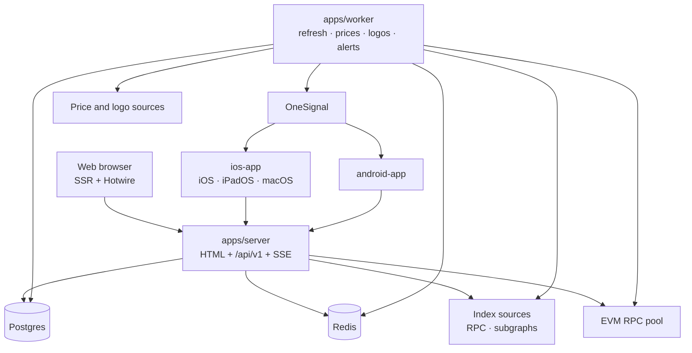
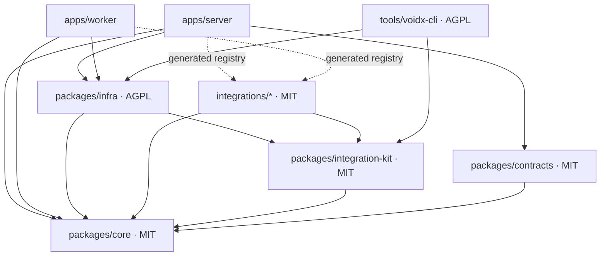
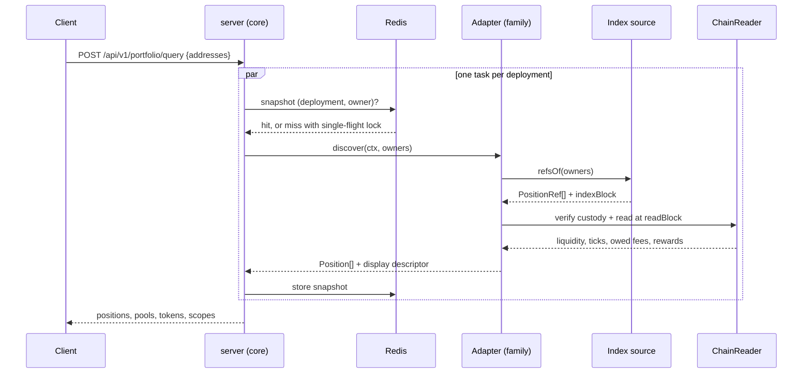

# Architecture

What exists and how it fits together. Reasons live in the linked ADRs.

## System

- `server` serves HTML pages and fragments, the JSON API, the SSE stream and re-hosted logos (`/api/v1/logos`) from one process ([ADR 0028](decisions/0028-server-stack.md), [ADR 0046](decisions/0046-token-logos.md)).
- `worker` refreshes watch targets, prices and the logo index, and sends alerts ([ADR 0026](decisions/0026-worker-and-alerts.md), [ADR 0045](decisions/0045-token-prices.md), [ADR 0046](decisions/0046-token-logos.md)).
- Clients are thin: they format values the server derived ([ADR 0003](decisions/0003-server-owns-protocol-logic.md)).
- Push goes through OneSignal behind the `Notifier` port ([ADR 0014](decisions/0014-push-via-onesignal.md)).

## Packages and dependency direction

| Package | Owns | License |
|---|---|---|
| `packages/core` | Domain types, ports, use cases (`core/domain`, `core/ports`, `core/use-cases`). Imports nothing outside itself. | MIT |
| `packages/contracts` | Zod DTOs, generated `openapi.json`, golden fixtures | MIT |
| `packages/integration-kit` | `defineProtocol`, index sources, staking plugins, math, conformance suite, record and replay | MIT |
| `packages/infra` | Transports, repositories, cache, event bus, job queue, notifier, `instance.config` | AGPL-3.0-or-later |
| `packages/design-tokens` | DTCG tokens for colour, type, spacing, motion, icons | MIT |
| `integrations/` | Protocol families, chain files, own subgraphs | MIT |
| `tools/voidx-cli` | The `voidx` developer CLI ([ADR 0053](decisions/0053-developer-cli.md)) | AGPL-3.0-or-later |
| `e2e/` | Maestro flows for every app ([ADR 0048](decisions/0048-e2e-testing.md)); not a package | MIT |

Rules, enforced by dependency-cruiser (*planned*):

- `core` imports nothing outside itself.
- Integrations import only `core` ports and `integration-kit`; never `infra`, never each other.
- MIT packages never import AGPL packages.
- Only `apps/*` know concrete infrastructure; they wire it in `createRoot` ([ADR 0005](decisions/0005-dependency-injection.md)).

## Reading a portfolio

A deployment that fails or passes the deadline becomes a scope with status `failed`; the rest of the portfolio still returns ([concepts/data-rule.md](concepts/data-rule.md)).

## Where to read next

| Topic | Doc |
|---|---|
| Index, chain and blocks | [concepts/data-rule.md](concepts/data-rule.md) |
| What clients receive | [concepts/position-model.md](concepts/position-model.md) |
| What an integration is | [concepts/integration-model.md](concepts/integration-model.md) |
| Lifecycle and statuses | [concepts/state-model.md](concepts/state-model.md) |
| RPC pool and caching | [concepts/providers-and-cache.md](concepts/providers-and-cache.md) |
| Failure handling and cost | [concepts/resilience.md](concepts/resilience.md) |
| Feature flags | [concepts/feature-flags.md](concepts/feature-flags.md) |
| Plans and limits | [concepts/plans-and-entitlements.md](concepts/plans-and-entitlements.md) |
| Each app | `apps/<app>/docs/` |
